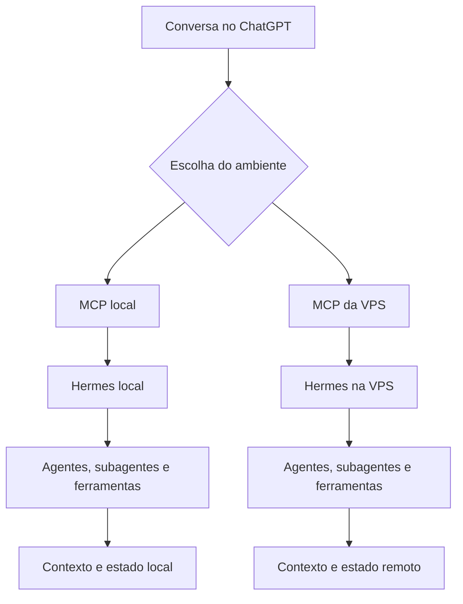

# Chassi_Hermes

Uma base pública para aprender, documentar e reproduzir uma arquitetura de agentes com memória persistente, começando por um ambiente Linux local e evoluindo até uma operação remota.

**Esta primeira entrega contém documentação, um exemplo de configuração e um modelo de registro de tarefa.** A base WSL foi aplicada manualmente em uma instalação de referência. A integração entre ChatGPT, MCP, Hermes e agentes continua planejada neste repositório. A reconstrução completa da arquitetura ainda não foi validada.

O repositório público do chassi é [Chassi_Hermes](https://github.com/mide-lim/Chassi_Hermes). A configuração particular do Hermes e os contextos dos projetos permanecem em repositórios privados separados.

## Estado da primeira entrega

| Parte | Estado | Evidência ou limite |
| --- | --- | --- |
| Base Linux local | Aplicada manualmente | Instalação de referência com Ubuntu 24.04, WSL 2 e capacidade observada compatível com o máximo pretendido de 512 GB; confirmação por saídas de terminal compartilhadas |
| Guia público de instalação | Documentado | Usa nomes e caminhos genéricos; a reprodução integral por uma terceira pessoa permanece pendente |
| Hermes, MCP local e agentes | Planejados | Este pacote não instala nem valida esses componentes |
| Integração local/VPS | Planejada | Responsabilidades definidas; procedimentos de instalação e transferência ainda precisam de validação |
| CI no GitHub | Próximo incremento | Nenhum workflow está incluído nesta entrega |
| Reconstrução e recuperação completas | Pendentes | Não há ensaio completo de restauração validado |

## Chassi público e almas privadas

O chassi reúne o que pode ser reutilizado: arquitetura, contratos entre componentes, documentação, exemplos e, nos próximos incrementos, skills e ferramentas genéricas.

As almas ficam em repositórios privados separados. O repositório privado do Hermes concentra sua configuração particular de orquestração e o índice dos projetos. Cada projeto mantém seu próprio repositório privado, com contexto, decisões e memória pertinentes.

| Destino lógico | Conteúdo |
| --- | --- |
| Chassi_Hermes | Estrutura reutilizável, procedimentos, contratos, exemplos e evidências publicáveis |
| Repositório privado do Hermes | Configuração da instância, regras particulares, índice dos projetos e registros de coordenação |
| Um repositório privado por projeto | Contexto, decisões, memória textual selecionada e referências aos resultados daquele projeto |

Um aprendizado particular pode gerar uma contribuição pública após revisão e remoção do conteúdo privado. Contribuições ao Chassi_Hermes partem de conteúdo selecionado e revisado. A seleção precisa considerar também exemplos, referências e histórico que acompanhem o material.

## Arquitetura proposta

O fluxo começa na conversa. A pessoa escolhe o ambiente de execução, o MCP oferece as operações disponíveis naquele ambiente e o Hermes organiza o trabalho dos agentes.

Este desenho expressa o objetivo da arquitetura. As capacidades e permissões de cada MCP ainda precisam ser verificadas na instalação correspondente. MCP é a entrada de integração; acesso administrativo ao Linux depende da identidade e das operações efetivamente disponibilizadas.

### Responsabilidades dos ambientes

| Elemento | Papel previsto |
| --- | --- |
| Local | Desenvolvimento e testes principais; homologação técnica quando as integrações necessárias estiverem disponíveis; aprendizado com IA local |
| VPS | Hospedagem pública e operação autônoma; continuidade do trabalho quando o computador local estiver indisponível, preservando os serviços hospedados |
| GitHub | Código, configuração compartilhável, documentação e memória textual selecionada; verificações automatizadas a introduzir depois desta documentação |
| ChatGPT | Planejamento, desenvolvimento, revisão, ensino e acionamento das ferramentas disponíveis |
| Sites e Vercel | Prévias de interface e showcases; cada publicação terá seu próprio procedimento |

Local e VPS terão uma arquitetura lógica comum. Versões, contratos e procedimentos devem ser identificáveis, enquanto credenciais, dados, capacidade e recursos de IA podem variar por ambiente.

A referência completa será consolidada primeiro na VPS e depois reproduzida no local. A preparação antecipada da base WSL já permite organizar o trabalho local sem antecipar a validação do restante da arquitetura.

### Passagem de trabalho entre ambientes

Cada tarefa deve ter um ambiente responsável identificado. Uma transferência exige registrar seu último estado conhecido, conferir resultados e decidir o ponto de retomada.

Trocar de MCP na conversa não transfere automaticamente processos, arquivos ou tarefas em andamento. O [modelo de tarefa](templates/tarefa.json) ajuda a registrar a passagem, mas não implementa bloqueio de concorrência nem autoriza uma execução.

## Caminho de evolução

1. **Manter a base documental.** Registrar a instalação observada, os exemplos genéricos e as decisões abertas nos repositórios adequados.
2. **Introduzir CI proporcional.** Automatizar verificações úteis desta base; incluir testes do software conforme os componentes forem incorporados.
3. **Consolidar a referência na VPS.** Instalar ou ajustar os componentes necessários, registrar suas versões e validar uma tarefa representativa.
4. **Reproduzir a arquitetura no local.** Aplicar a mesma base versionada com as diferenças de configuração documentadas.
5. **Ensaiar reconstrução e retomada.** Recuperar software e estado a partir dos materiais persistidos e registrar o resultado real.

CI verifica mudanças. Implantação e publicação continuam sendo etapas próprias. O uso de modelos de IA em testes também deverá ter escopo e custo definidos.

A documentação pública deve começar por níveis úteis: versionamento e registro de contexto no GitHub; verificações com CI; base Linux e agentes com memória; integração de ferramentas via MCP; e operação remota com continuidade. Cada nível acrescenta uma capacidade da arquitetura assistida por IA. A VPS não é requisito para iniciar o aprendizado.

## Como ler o repositório

- [Fronteiras entre chassi e almas](docs/fronteiras-chassi-almas.md): responsabilidades, destinos da memória e decisões de implementação.
- [Instalação manual da base WSL](docs/instalacao-wsl.md): configuração, criação e verificações.
- [Persistência e evolução](docs/persistencia-e-evolucao.md): o que guardar no Git, o que requer backup e como registrar continuidade.
- [Exemplo de configuração do WSL](examples/wslconfig.example): chave de tamanho máximo para novos discos.
- [Modelo de tarefa](templates/tarefa.json): registro pequeno para contexto, executor e retomada.
- [Regras iniciais de exclusão do Git](.gitignore): arquivos locais que não devem entrar automaticamente neste chassi público.

## Critério de pronto desta etapa

A entrega documental deve descrever o estado observado, manter explícitas as partes planejadas, usar exemplos genéricos e permitir identificar o próximo incremento. A implementação do CI e os ensaios de reconstrução exigem suas próprias evidências.

## Licença

A licença deste repositório ainda não foi escolhida. Essa decisão deve ser registrada antes da distribuição pública definitiva.
